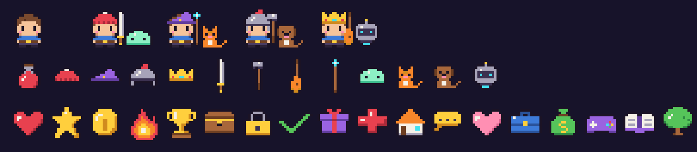

# Personal OS Quest

*A Fractal Studios product. The source is public for viewing; all rights reserved (see [LICENSE](LICENSE)).*

A small Habitica-style RPG for personal development, with a second module for goals and daily practice. Both share one character, one SQLite database and the same nine life domains.

- **Quest board**: dailies, habits and to-dos earn XP and gold, missed dailies cost HP, and a pixel hero levels up and buys gear.
- **Life goals**: 90-day season goals broken into monthly milestones and weekly targets, a Today view with trackers and protocol checks, and weekly and yearly reviews. A small toolkit of frameworks (RPM, 80/20, fear-setting, ikigai, kaizen, hansei, WOOP and more) sits alongside. Work you do here feeds the same hero.

You can play in the browser or in Discord. Everything runs offline: no deploy, no accounts, no cloud.



*Placeholder pixel sprites, generated in code by `packages/sprites`.*

---

## Run it

You need **Node.js 22.13 or newer**. The app uses Node's built-in SQLite, so nothing native has to compile. Check your version with `node -v`.

```bash
npm install
cp .env.example .env      # optional for the web app, required for the Discord bot
npm run dev               # API on http://127.0.0.1:8787 + web app on http://127.0.0.1:5173
```

Open **http://127.0.0.1:5173**. On first start the API creates `data/quest.db` and seeds two things: your hero with the daily schedule, and your seven starting goals with their linked quests. Use the switch under the hero to move between **Quest board** and **Life goals**.

For the Discord bot, open a second terminal once `DISCORD_TOKEN` is set (see [Discord bot](#discord-bot)) and run:

```bash
npm run bot
```

| Command | What it does |
| --- | --- |
| `npm test` | 89 tests: core rules, goals roll-up and quest sync, API, bot |
| `npm run typecheck` | TypeScript checks for every package |
| `npm run build`, then `npm start` | Builds the web app and serves app and API together on http://127.0.0.1:8787 |
| `npm run sprites` | Regenerates the PNG sprite sheets from `packages/sprites/src/art.ts` |
| `npm run db:reset -- --yes` | Deletes the database so the next start re-seeds it (stop the server first) |

To back up your progress, copy `data/quest.db` while the server is stopped.

---

## Life goals module

### Structure

- **Three levels.** Season goals (90 days) contain monthly milestones, which contain weekly targets. Each goal belongs to one of the nine domains.
- **Tasks.** Each goal has a Massive Action Plan of tasks. You can tag a task as 80/20 (★, high leverage), give it a due date, add an "easy version" note, pin it to Today's top 3, or push it to the quest board.
- **Pushing tasks.** A pushed task becomes a to-do on the quest board. Ticking it on either side ticks the other, and XP and gold come from the RPG rules. Tasks that were never pushed can still be ticked off, but they don't pay XP.
- **Trackers.** A tracker goal (smoking, wake, gym, run, sunlight, pomodoros, meals) is linked to one quest. Logging the tracker completes that quest, and ticking the quest adds a minimal log entry.
- **Progress roll-up.** A goal with a tracker is measured by that tracker over its own window, for example smoke-free days / 90. A goal without a tracker averages its milestones, targets and tasks equally. A done goal counts 100% and a dropped one is ignored. Rings are coloured by pace and also labelled ("on pace", "a bit behind", "behind").

### Pages

| Page | What's on it |
| --- | --- |
| **Today** | Top 3 tasks, the week's lead domino, a 25/5 Pomodoro timer (configurable; each finished pomodoro earns XP) and a mood/energy check-in. Below that: Ichigo ichie and Kaizen notes, all trackers, protocol checks, and recent entries with undo. |
| **Goals** | Season ring and streak tiles, then a card per goal with a progress ring, milestones and the linked quest. Below them, the nine-domain wheel score over 12 weeks as small multiples. |
| **Review** | The week in numbers (this week or last week), hansei, the 80/20 review, next week's lead domino, a one-click "create next week's targets", and the yearly wheel of life review (rate 1-10 with notes and a radar). |
| **Toolkit** | Identity statement and habit stacks, the ikigai map, fear-setting worksheets, and settings: wake target, pomodoro lengths, meal times, bedtime, smoking prices and protocol toggles. |

### Frameworks (each has a one-line tooltip in the app)

| Source | Built in as |
| --- | --- |
| Tony Robbins | RPM on every goal (Result, Purpose, Massive action plan); yearly wheel of life review |
| Tim Ferriss | 80/20 task flag and weekly 80/20 review; "what would this look like if it were easy?" on goals and tasks; fear-setting worksheet; weekly lead domino |
| Japanese principles | Ikigai map; kaizen 1% daily note with streak; hansei weekly reflection; Ichigo ichie daily presence/gratitude note |
| Huberman-style protocols | Optional daily checks: morning sunlight, focus block up to 90 min, movement, cold/heat exposure, caffeine timing, wind-down, sleep window. Labelled **general wellbeing habits, not medical advice**, and each can be switched off |
| Psychology | If-then plans (implementation intentions) per goal, habit stacking, WOOP per goal, identity statement, daily 1-5 mood/energy check-in |

### Your starting goals (seeded)

Each goal is a 90-day season goal starting the day you first run the app. Each one gets a Month 1 milestone, a target for the rest of the current week, and one linked quest. Purpose, WOOP, identity and action plans are left blank for you to write.

| Goal | Domain | Tracker and quest | Notes |
| --- | --- | --- | --- |
| Example: quit a habit | Health | Daily "Smoke-free today" (**forgiving**: missing it costs no HP) | Smoke-free counter, cigarettes-per-day chart, craving log with your if-then plan ("if I crave a cigarette, then 10 deep breaths + a 5-minute walk"), badges at 1 day, 3 days, 1 week, 1 month and 3 months. A slip unticks the day without HP loss and shows "reset and keep going". Money saved stays hidden until you set cigarettes/day, pack price and pack size: nothing is assumed. The tooltip includes Tabac Info Service (39 89, tabac-info-service.fr). |
| Wake up at 08:00 every day | Health | Daily "Wake up by 08:00" | Check-in with the time logged, an on-time streak (15 min grace), and this week's and last week's average |
| Gym at least every 2 days | Health | Habit "Gym session" | Rolling 48-hour rule: OK, then amber "go today" after 24 h, then red "overdue" after 48 h, on both the card and the quest |
| Run every day | Health | Daily "Run" | Optional minutes and km, run-day streak, weekly totals |
| Morning sunlight | Health | Daily "Morning sunlight" | Minutes outside, minutes after waking, the 30-60 min window |
| Pomodoro technique | Career | Daily "Deep work: pomodoros" | 25/5 timer, counts per day, per goal and per task. Each pomodoro earns XP, and the daily completes itself at your target (default 4/day) |
| Healthy meals at regular times | Health | Daily "3 healthy meals on time" | Breakfast 09:00, lunch 12:30 and dinner 19:30 with a healthy yes/no; off-schedule meals are flagged |

---

## Quest board (the RPG)

| Thing | Rule |
| --- | --- |
| **Dailies** | Check once per game day. Rewards by difficulty: trivial 5 XP / 2 gold, easy 10 / 4, medium 15 / 6, hard 20 / 8. Each streak day adds +2.5%, capped at +50%. |
| **Forgiving dailies** | A missed day breaks the streak but costs no HP. Toggle it in a daily's editor. |
| **Habits** | `+` earns like a to-do. `−` costs HP: trivial 1, easy 2, medium 3, hard 4. |
| **To-dos** | One-off tasks. Same rewards as dailies, no streak. |
| **Undo** | Unchecking reverses exactly what was granted. |
| **Life stats** | Quests, logs and rituals add 1 / 1 / 2 / 3 points (trivial to hard) to their domain. |
| **Levels** | XP to the next level = 100 × level^1.5, rounded to 10 (100, 280, 520, 800…). Each new level refills HP and unlocks gear. |
| **Day reset** | Default **04:00 Europe/Paris** (set per player). Missed due dailies cost HP, streaks break, checkboxes clear. If you were away several days, only the last day is charged. |
| **Fainting** | At 0 HP you lose one level and half your gold, then HP refills. |
| **Rest mode** | A Settings toggle for travel, shoots or sick days: no damage, and streaks are frozen. |
| **Shop** | Your own rewards plus hats, weapons, pets and potions, unlocked by level. |

All balancing numbers live in `packages/core/src/rules.ts` and `packages/core/src/goals/sync.ts`.

**Note on balance:** with the schedule and the goal quests together there are 19 dailies. Missing all of them costs 44 of your 50 HP, and missing a third costs about 15 HP a day. See CHANGELOG, "Before you use it daily".

---

## Discord bot

The bot is a second front end on the same API and database, so the API must be running (`npm run dev` or `npm start`).

### 1. Create the bot

1. Go to https://discord.com/developers/applications and click **New Application**.
2. Open the **Bot** page, click **Reset Token**, and paste the token into `.env` as `DISCORD_TOKEN=`. Treat it like a password and never commit it. If it leaks, reset it again.
3. No privileged gateway intents are needed.
4. In **OAuth2 → URL Generator**, tick the scopes `bot` and `applications.commands`, then open the generated URL and add the bot to your server. The bot also prints an invite link when it starts.

### 2. Point it at you and your server

Turn on Developer Mode in Discord (User Settings → Advanced), then:

- **Server ID:** right-click your server, choose **Copy Server ID**, and set it as `DISCORD_GUILD_ID` in `.env`. Commands then appear instantly in that server.
- **User ID:** right-click your name, choose **Copy User ID**, and set it as `DISCORD_OWNER_ID`. Your Discord account then controls the same hero and goals as the web app.

### 3. Run it

```bash
npm run dev     # terminal 1
npm run bot     # terminal 2
```

### Commands

| Command | Does |
| --- | --- |
| `/goal list` | Season goals with progress bars and pace |
| `/goal progress <id>` | One goal: tracker, RPM, if-then, milestones, action plan (the id autocompletes) |
| `/today` | Top 3, lead domino, all trackers (smoke-free, wake, sunlight, run, gym 48h, meals, pomodoros), protocol checks, check-in |
| `/review [went-well] [didnt] [change]` | This week in numbers and weekly targets. Adding text saves your hansei |
| `/log wake/sun/run/gym/meal/craving/smoke/pomodoro/mood` | Log from your phone. Same effects as the web app (quests complete, XP, if-then reminder on cravings, no HP for slips) |
| `/quest list`, `/quest done/undo/add`, `/habit`, `/stats`, `/shop`, `/buy`, `/daily-reset` | The quest board, as before |

Replies are private (only you see them). `/stats share:true` posts publicly.

---

## Multi-player

- Each Discord user gets their own player. The account in `DISCORD_OWNER_ID` takes over the local hero.
- Other players start with an empty goals module, not your seven goals.
- In the web app, **Settings → Players** switches between players or adds one.
- There is no login. The API listens on `127.0.0.1` only, so don't expose it to a network as it is.

---

## Architecture

```
packages/
  core/     Pure rules, no I/O. RPG: XP, levels, HP, streaks, time-zone-aware day reset.
            Goals (core/src/goals): levels, trackers, progress roll-up, quest sync, rewards, validation, seed.
  sprites/  16x16 pixel art as palette grids, compositing, PNG encoder.
  server/   Hono API over SQLite (node:sqlite). GoalService shares the RPG transaction, lazy reset and event log.
  web/      Vite + React. Quest board and Life goals, dark pixel UI, mobile layout.
  bot/      discord.js slash commands, talking only to the API.
```

Every write goes through one transaction that loads the player, rolls the day over if due, applies one rule from `core`, saves, and appends to the event log. The event log feeds the 7-day wheel, the 12-week wheel history and the weekly review.

### API

`:pid` is a player id or `local`. RPG responses return `{ ok, notices, state }`. Goal responses also include `goals`.

| Method | Path | Body |
| --- | --- | --- |
| GET | `/api/players` · POST `/api/players` · POST `/api/players/resolve` | `{ name }` · `{ discordId, name, claimLocal }` |
| GET | `/api/players/:pid/state` · PATCH `/api/players/:pid` | `{ name?, settings? }` |
| POST/PATCH/DELETE | `/api/players/:pid/tasks[/:id]` · POST `.../complete`, `.../uncomplete`, `.../score` | task fields · `{ direction }` |
| POST/PATCH/DELETE | `/api/players/:pid/rewards[/:id]` · POST `/buy`, `/equip`, `/reset` | |
| GET | `/api/players/:pid/goals` | |
| POST/PATCH/DELETE | `/api/players/:pid/goals[/:id]` | `{ title, domain, level, parentId?, result, purpose, easy, identity, woop, ifThen, metric?, startDay?, endDay?, status? }` |
| POST | `/api/players/:pid/goals/plan-next-week` | |
| POST/PATCH/DELETE | `/api/players/:pid/goal-tasks[/:id]` | `{ goalId, title, difficulty?, due?, leverage?, easy?, push?, top3? }` |
| POST | `/api/players/:pid/goal-tasks/:id/complete` · `/uncomplete` · `/push` | |
| POST/DELETE | `/api/players/:pid/logs[/:id]` | `{ kind: smoke\|craving\|wake\|gym\|run\|sun\|meal\|pomodoro, value?, value2?, tag?, note?, goalId?, taskId?, dayKey? }` |
| PUT/DELETE | `/api/players/:pid/journal/:kind/:period` | `{ data }`; kinds: checkin, gratitude, kaizen, protocols (day) · hansei, pareto, lead (Monday of the week) · yearReview (year) · ikigai, identity, settings (`main`) · fear (id) |
| GET | `/api/players/:pid/avatar.png?scale=8` | |

### Configuration (`.env`)

| Variable | Default | Used by |
| --- | --- | --- |
| `PORT` / `HOST` | `8787` / `127.0.0.1` | API (the web dev proxy follows `PORT`) |
| `DB_PATH` | `./data/quest.db` | API |
| `DEFAULT_TIMEZONE` / `DEFAULT_RESET_TIME` | `Europe/Paris` / `04:00` | New players |
| `PLAYER_NAME` | `Example Hero` | Local hero on first run |
| `DISCORD_TOKEN` · `DISCORD_GUILD_ID` · `DISCORD_OWNER_ID` | (none) | Bot |
| `API_URL` | `http://127.0.0.1:8787` | Bot |

---

## Tests

`npm test` runs 89 tests with Node's built-in runner:

- **Core RPG (37):** XP and the level curve, HP damage, fainting, streaks, the 04:00 Paris boundary across the 25 Oct DST change, the day reset, the shop and undo.
- **Core goals (20):**
  - progress roll-up: tracker goals, default targets, milestones and tasks, three levels, done/dropped
  - the smoking counter, badges and unknown money
  - wake streak and averages
  - the gym 48h rule
  - meals, sunlight and pomodoros
  - quest sync both ways: pushed tasks with XP and undo, mirroring, tracker → quest, quest → tracker
  - rewards, forgiving dailies, validation and the seed
- **API (19):** seeding, roll-up through the API, quest sync over HTTP, tracker sync, smoking slips with no HP, badges paid once, the gym overdue alert, pomodoro XP and refund, journal payouts, next-week planning, the top-3 limit, plus the RPG endpoints.
- **Bot (13):** command definitions against Discord's limits, every command and autocomplete against the real API in-process, and embed size limits.

## Troubleshooting

- **"needs Node.js 22.13 or newer"**: upgrade Node.
- **The web app can't reach the API**: check the `[api]` lines printed by `npm run dev`, or change `PORT` in `.env`.
- **Slash commands don't show up**: set `DISCORD_GUILD_ID`, and make sure the invite included `applications.commands`.
- **Quit-smoking support (France)**: Tabac Info Service, 39 89, https://www.tabac-info-service.fr/.

## Collaborating
- Read `CLAUDE.md` first. It's the brief for humans and AI assistants alike.
- Branch from `main` and keep each change small (one PR per feature or fix). Run `npm test` before pushing.
- The web app (`packages/web`) is open for work. The Discord bot (`packages/bot`) is owned by another stream; coordinate before touching it.
- Never commit `.env`, tokens or real personal data. The seed data is examples only.

## Licence

Copyright © 2026 David Amos, trading as Fractal Studios. All rights reserved. The code is published for viewing only; see [LICENSE](LICENSE).
